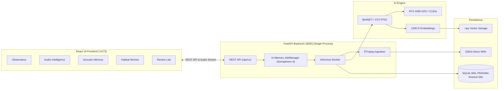

# EcoSonic 2.0 — AI-Powered Bioacoustic Intelligence Platform

EcoSonic 2.0 is a comprehensive, production-grade bioacoustic intelligence and environmental monitoring platform. It integrates state-of-the-art acoustic neural networks (**BirdNET+ V3.0**) with an asynchronous **FastAPI** backend and a scientific research dashboard built in **React 19**, **TypeScript**, and **Tailwind CSS**.

---

## 1. System Architecture

EcoSonic 2.0 uses a **Single-Process Async Architecture** designed for single-node scientific workstations and field stations:



> [!WARNING]
> **Deployment Constraint — Single-Process Deployment Only:**
> The backend `JobManager` manages active task concurrency in-process via `asyncio.Semaphore` and in-memory tracking dictionaries. It is designed and validated to run as **one uvicorn process** (e.g. `uvicorn app.main:app` without `--workers`). Multi-worker deployments (e.g. `--workers 4`) and horizontal multi-replica pods are **unsupported** in this release because:
> 1. Job states, progress meters, and cancellations would be isolated to individual worker processes.
> 2. Polling requests would randomly hit workers that do not own the in-memory task.
> 3. SQLite write concurrency under multiple independent processes is subject to lock contention despite WAL mode.
> Horizontal multi-worker scaling requires external brokers (Celery/Redis) and a client-server RDBMS (PostgreSQL).

### Key Capabilities:
- **Audio Ingestion & Normalization:** Standardizes multi-format audio uploads (WAV, MP3, FLAC, OGG, M4A up to 50 MB) into 32,000 Hz 16-bit PCM Mono WAV via FFmpeg.
- **Deep Bioacoustic Classification:** Evaluates audio against 11,725 biological species and sound categories using official BirdNET+ V3.0 FP32 ONNX weights with NVIDIA CUDA GPU acceleration.
- **High-Dimensional Acoustic Memory:** Extracts 1,280-dimensional latent embeddings, saved atomically as `.npy` arrays for sound similarity search and latent space exploration.
- **Interactive Visualizations:** High-fidelity WaveSurfer.js audio waveform seeking, Leaflet monitoring site maps, and Recharts taxa distribution graphs.
- **Human-in-the-Loop Review Lab:** Expert verification workflow (Confirm, Reject, Uncertain) to audit model classifications and train downstream models.

---

## 2. Prerequisites & Environment

### Hardware Requirements:
- **CPU:** 4+ cores (x86_64 or Apple Silicon).
- **RAM:** 8 GB minimum (16 GB recommended).
- **GPU (Recommended):** NVIDIA GPU with CUDA 12.x support (e.g., RTX 3060/4060 or higher). Automatic fallback to CPU is supported.
- **Disk:** ~2 GB free disk space (includes ~350 MB cached model weights).

### Software Requirements:
- **Python:** 3.11.x (tested on 3.11.15).
- **Node.js:** v18.x or v20.x+ (tested on Node v22.14.0 with npm 10.9.2).
- **FFmpeg:** System FFmpeg or Python `imageio-ffmpeg` package (pre-configured).

---

## 3. Installation & Quickstart

### Step 1: Clone and Set Up Workspace
```bash
git checkout integration/ecosonic-v1
```

### Step 2: Backend Setup (Python 3.11)

Create and activate a Python 3.11 virtual environment:
```powershell
# Using uv (recommended)
uv venv .venv --python 3.11
.venv\Scripts\activate

# Install dependencies (CPU baseline)
pip install -r backend/requirements-backend.txt
pip install -r requirements.txt

# For NVIDIA CUDA GPU acceleration (optional, Windows/Linux):
pip uninstall onnxruntime -y
pip install -r requirements-gpu.txt
```

Set the model cache environment variable:
```powershell
$env:BIRDNET_APP_DATA = "$PWD\.model_cache"
$env:PYTHONPATH = "$PWD\backend;$PWD"
```

### Step 3: Frontend Setup (React + Vite)
```powershell
cd frontend
npm install
cd ..
```

---

## 4. Running the Platform

### Start the Backend Server:
```powershell
# From project root
$env:PYTHONPATH = "backend;."
$env:BIRDNET_APP_DATA = "$PWD\.model_cache"
.venv\Scripts\python -m uvicorn app.main:app --reload --host 0.0.0.0 --port 8000
```
- Swagger Interactive Documentation: [http://localhost:8000/docs](http://localhost:8000/docs)
- Alternative Redoc Documentation: [http://localhost:8000/redoc](http://localhost:8000/redoc)
- Health Check: [http://localhost:8000/health](http://localhost:8000/health)

### Start the Frontend Development Server:
```powershell
cd frontend
npm run dev
```
Open [http://localhost:5173](http://localhost:5173) in your browser.

---

## 5. Running the Test Suites

### 1. Fast Backend Hardening & Unit Tests (Excludes heavy model inference)
```powershell
$env:PYTHONPATH = "backend;."
.venv\Scripts\pytest backend/tests -v -m "not real_model"
```
*Expected: 41 passed in ~7.7s (covers audio robustness matrix, API contract audit, restart recovery, embedding consistency, security audit, and concurrency load tests).*

### 2. Real Model Pipeline & Hardware Fallback Acceptance Suite
```powershell
$env:PYTHONPATH = "backend;."
.venv\Scripts\pytest backend/tests -v -m "real_model"
```
*Expected: 4 passed in ~37s (verifies full HTTP ingestion across 3 environmental recordings, 3 concurrent real-model analyses, CUDA GPU inference, and CPU fallback).*

### 3. BirdNET Model Smoke & Edge Case Suite
```powershell
$env:PYTHONPATH = "."
.venv\Scripts\python backend/tests/smoke_test_birdnet.py
```
*Verifies model checksums, 1280-D embeddings, and zero-variance/short-audio edge cases.*

### 4. Frontend Vitest Unit Tests
```powershell
npm test --prefix frontend
```
*Expected: 12 passed in ~0.6s.*

### 5. Frontend Production Build
```powershell
npm run build --prefix frontend
```
*Generates optimized production bundle in `frontend/dist/`.*

---

## 6. Project Layout

```
ECOBIRDS/
├── backend/
│   ├── app/
│   │   ├── main.py                  # Application entry point & lifespan
│   │   ├── config.py                # Pydantic settings & thresholds (50MB)
│   │   ├── api/v1/                  # REST endpoints (analyses, detections, acoustic, sites, reports)
│   │   ├── core/                    # Database engine, JobManager, logging, exceptions
│   │   ├── models/                  # SQLAlchemy async ORM models
│   │   ├── schemas/                 # Pydantic V2 request & response schemas
│   │   ├── services/                # AudioProcessor, StorageService, BirdNetEngine, Pipeline
│   │   └── workers/                 # Background analysis task workers
│   ├── data/smoke_audio/            # Real environmental recordings for testing
│   ├── test_results/                # Test outputs, smoke JSON reports, embeddings
│   └── tests/                       # Unit and real-model integration test suites
│
├── frontend/
│   ├── src/
│   │   ├── pages/                   # Observatory, AudioIntelligence, AcousticMemory, HabitatMonitor, ReviewLab
│   │   ├── components/              # WaveSurfer players, Recharts visualizations, Leaflet maps
│   │   ├── services/                # Axios API service clients (/api/v1)
│   │   ├── types/                   # TypeScript interfaces matching backend schemas
│   │   └── tests/                   # Frontend Vitest test specifications
│   ├── package.json
│   └── vite.config.ts
│
├── docs/
│   ├── API_CONTRACT_AUDIT.md        # Comprehensive endpoint audit & contract mappings
│   ├── SYSTEM_INTEGRATION_REPORT.md # Consolidation report across ML, backend, & frontend
│   └── END_TO_END_TEST_REPORT.md    # Evidence and verification logs for all test suites
│
├── .model_cache/                    # Local workspace cache for BirdNET ONNX model
└── README.md
```

---

## 7. Licensing & Attribution

- **BirdNET Model Weights:** Official BirdNET V3.0 model weights are licensed under the Apache 2.0 license by the Cornell Lab of Ornithology and Chemnitz University of Technology. A separate acceptable-use policy applies for commercial usage.
- **BirdNET Python Library:** MIT License.
- **Application Code:** Developed under EcoSonic 2.0.
