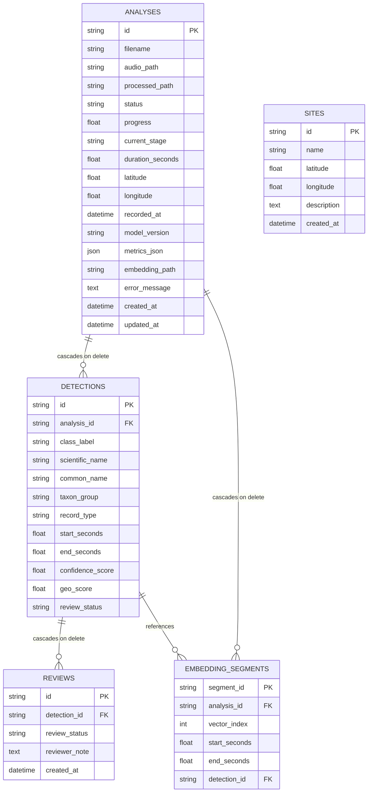

# EcoSonic 2.0 — Backend Foundation & Model Integration Guide

> **Phase 2 update:** The current integrated implementation, verified API results,
> test commands, current branch audit, and frontend handoff are documented in
> [docs/PHASE_2_INTEGRATION_REPORT.md](../docs/PHASE_2_INTEGRATION_REPORT.md).
> This guide records the earlier backend-foundation snapshot; its original branch,
> test count, 256 MB limit, and 48 kHz storage example are historical and have
> been superseded by the Phase 2 report and the code.

## 1. Executive Summary

This document serves as the formal architectural and interface contract between the **Backend Infrastructure** (Task 02) and the **BirdNET+ Model Integration** (Task 01).

The backend foundation provides a modular, production-ready FastAPI application built on Python 3.11, SQLAlchemy 2.0 with asynchronous SQLite (`aiosqlite`), an in-process background job execution manager, robust multi-format audio ingestion via FFmpeg, and an API v1 surface for bioacoustic intelligence.

---

## 2. Parallel Execution & Branch Safety

- **Working Branch**: `feature/backend-foundation`
- **Protected Files**: The model-integration files (`birdnet_engine.py`, `smoke_test_birdnet.py`, model weights/caches) were strictly preserved without overwriting.
- **Merge Strategy**: Manual review and merge into `main` after both agents complete their validation passes.

---

## 3. Directory Layout

```
backend/
├── app/
│   ├── main.py                  # FastAPI application entrypoint with lifespan & exception handlers
│   ├── config.py                # Environment-driven settings (pydantic-settings)
│   ├── dependencies.py          # Dependency injection for repositories & database sessions
│   │
│   ├── api/
│   │   └── v1/
│   │       ├── router.py        # Central V1 APIRouter aggregator
│   │       ├── analyses.py      # Audio upload, async job triggering, polling, deletion
│   │       ├── detections.py    # Detections query with filters, human verification reviews
│   │       ├── acoustic.py      # Signal inspection, container probe, audio streaming
│   │       ├── sites.py         # Monitoring site CRUD operations
│   │       └── reports.py       # Biodiversity intelligence summary and CSV dataset export
│   │
│   ├── core/
│   │   ├── database.py          # SQLAlchemy 2.x async engine, sessions, pragmas (WAL + FK)
│   │   ├── logging.py           # Standard structured logging
│   │   ├── exceptions.py        # Domain exceptions (AudioValidation, Processing, NotFound)
│   │   └── job_manager.py       # Asynchronous background job manager with cancellation & throttling
│   │
│   ├── models/
│   │   ├── analysis.py          # Analysis & EmbeddingSegment ORM entities
│   │   ├── detection.py         # Detection ORM entity
│   │   ├── site.py              # Monitoring Site ORM entity
│   │   └── review.py            # Expert Review ORM entity
│   │
│   ├── schemas/
│   │   ├── analysis.py          # Analysis Pydantic request/response schemas
│   │   ├── detection.py         # Detection & EmbeddingSegment Pydantic schemas
│   │   ├── site.py              # Site Pydantic schemas
│   │   └── common.py            # Pagination and message response wrappers
│   │
│   ├── services/
│   │   ├── audio_processor.py   # Multi-format audio validation, inspection & FFmpeg mono conversion
│   │   ├── storage_service.py   # Filesystem manager for raw audio, processed WAVs, and embeddings
│   │   └── analysis_pipeline.py # Orchestrator bridging audio preprocessing and BirdNetEngine
│   │
│   ├── repositories/
│   │   ├── analysis_repository.py  # Analysis and embedding database operations
│   │   ├── detection_repository.py # Detections and reviews database operations
│   │   └── site_repository.py      # Sites database operations
│   │
│   └── workers/
│       └── analysis_worker.py   # Background pipeline runner with stage & progress reporting
│
├── storage/                     # Base directory for raw audio, normalized WAVs, and embeddings
│   ├── raw/                     # storage/raw/<analysis_id>/<filename>
│   ├── processed/               # storage/processed/<analysis_id>/audio_mono_48k.wav
│   └── embeddings/              # storage/embeddings/<analysis_id>/embeddings.npy
│
├── tests/                       # Complete pytest suite (API, audio ingestion, DB, job manager)
├── requirements-backend.txt     # Python dependencies for backend service
├── Dockerfile                   # Production container definition
└── .env.example                 # Environment variable templates
```

---

## 4. Database Architecture & Schema

### Engine & Lifecycle
- **Technology**: SQLAlchemy 2.0 + SQLite with `aiosqlite`.
- **Concurrency & Integrity**: SQLite WAL mode enabled (`PRAGMA journal_mode=WAL`) with foreign key enforcement (`PRAGMA foreign_keys=ON`).
- **Initial-Schema Strategy**: Managed via `init_db()` lifecycle hook on FastAPI startup, running `Base.metadata.create_all` safely.

### Tables & Relationships



### Storage Isolation Rule
- Large raw audio files and converted mono WAV files reside on disk in `storage/raw/` and `storage/processed/`.
- Numerical embedding arrays (e.g., float32 matrices of shape `(N, 1280)`) are stored as binary `.npy` files in `storage/embeddings/`.
- Only segment metadata (`segment_id`, `analysis_id`, `vector_index`, `start_seconds`, `end_seconds`, `detection_id`) is stored in SQLite.

---

## 5. Audio Ingestion Pipeline (`audio_processor.py`)

Supported audio formats:
- **WAV** (`.wav`)
- **MP3** (`.mp3`)
- **FLAC** (`.flac`)
- **OGG** (`.ogg` with Vorbis or Opus)
- **M4A** (`.m4a` / AAC)

### Capabilities Implemented:
1. **Extension & MIME Validation**: Verifies extension and checks magic header bytes (`RIFF`, `fLaC`, `OggS`, `ID3`, `ftyp`).
2. **File-Size Validation**: Guards against zero-byte files and uploads exceeding `MAX_UPLOAD_SIZE_BYTES` (default 256MB).
3. **Corrupted-File Detection**: Probes headers via `soundfile` with seamless FFmpeg decoding error capture.
4. **Empty-Audio Detection**: Rejects empty containers, 0-frame streams, zero duration, or digital silence (flatline zero variance / RMS < 1e-7).
5. **Duration & Channel Inspection**: Extracts precise duration in seconds and detects mono, stereo, or multi-channel audio.
6. **Stereo-to-Mono Normalization**: Converts all ingested files to standardized 16-bit uncompressed PCM Mono WAV (`32000 Hz` native to BirdNET+ V3.0) via FFmpeg:
   ```bash
   ffmpeg -y -v error -i <input> -vn -ac 1 -ar 32000 -c:a pcm_s16le <output.wav>
   ```

---

## 6. Model Integration Contract (`BirdNetEngine`)

The backend pipeline communicates with the model via `AnalysisPipeline` and `BirdNetEngineAdapter`.

### Supported Method Signatures in `birdnet_engine.py`:

```python
class BirdNetEngine:
    def __init__(self, precision: str = "fp32", prefer_gpu: bool = True):
        ...

    def load(self) -> None:
        """Loads ONNX model weights and execution providers."""
        ...

    def predict(self, audio_path: str | Path) -> pd.DataFrame:
        """
        Runs model inference on standardized WAV audio.
        Returns DataFrame with columns:
        ['input', 'start_time', 'end_time', 'species_name', 'confidence']
        """
        ...

    def encode(self, audio_path: str | Path) -> EmbeddingBatch:
        """
        Extracts segment embeddings.
        Returns EmbeddingBatch with:
        - vectors: np.ndarray of shape (N, 1280)
        - segments: pd.DataFrame with ['input', 'start_time', 'end_time']
        """
        ...
```

The backend adapter handles automatic timestamp alignment, confidence threshold filtering, species binomial decomposition (`Passer domesticus_House Sparrow` -> `Passer domesticus` + `House Sparrow`), and persistence of `.npy` arrays.

---

## 7. REST API Surface

| Method | Endpoint | Description |
|---|---|---|
| `POST` | `/api/v1/analyses` | Upload audio (multipart/form-data) + coordinates; returns HTTP 202 Accepted. |
| `GET` | `/api/v1/analyses` | List analyses with pagination and status filtering. |
| `GET` | `/api/v1/analyses/{id}` | Detailed analysis view with all detections and embedding segments. |
| `GET` | `/api/v1/analyses/{id}/status` | Fast polling endpoint for UI progress bars (status, progress %, current stage). |
| `DELETE` | `/api/v1/analyses/{id}` | Cancels execution, cascades DB deletion, removes physical audio/embeddings. |
| `GET` | `/api/v1/analyses/{id}/embeddings/download` | Download `.npy` binary embedding file. |
| `GET` | `/api/v1/detections` | Query detections with filters (`analysis_id`, `min_confidence`, `species`, `review_status`). |
| `GET` | `/api/v1/detections/{id}` | Get single detection details with human review history. |
| `POST` | `/api/v1/detections/{id}/reviews` | Submit human verification review (`confirmed`, `rejected`, `uncertain`). |
| `GET` | `/api/v1/acoustic/inspect/{id}` | Acoustic signal characteristics (RMS, sample rate, channels, duration). |
| `GET` | `/api/v1/acoustic/stream/{id}` | Stream normalized WAV audio for waveform / spectrogram visualization. |
| `POST` | `/api/v1/sites` | Register a bioacoustic monitoring site. |
| `GET` | `/api/v1/sites` | List monitoring sites. |
| `GET` | `/api/v1/reports/summary` | Biodiversity intelligence summary (species count, detections, review metrics). |
| `GET` | `/api/v1/reports/export` | Export detections dataset to CSV for conservation researchers. |

---

## 8. Verification & Test Execution

Run the complete backend test suite:
```bash
pytest backend/tests -v
```

All 13 integration and unit tests pass in under 3.5 seconds:
- `test_health_and_root`
- `test_sites_api_flow`
- `test_analyses_upload_and_pipeline_flow`
- `test_reports_summary_and_export`
- `test_extension_validation`
- `test_file_size_validation`
- `test_corrupted_file_detection`
- `test_smoke_audio_inspection`
- `test_stereo_to_mono_conversion`
- `test_site_crud`
- `test_analysis_and_cascading_delete`
- `test_job_manager_lifecycle`
- `test_job_manager_cancellation`
