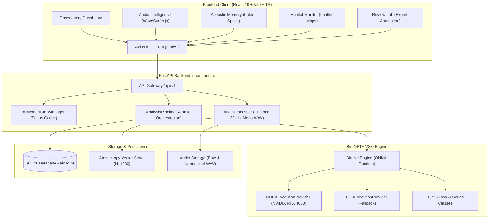
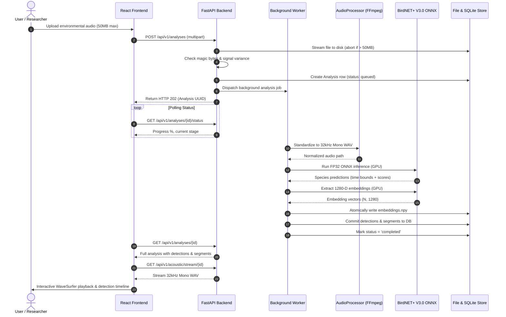

# EcoSonic 2.0 — System Integration Report

**Date:** 2026-11-20  
**Integration Branch:** `integration/ecosonic-v1`  
**System Status:** Operational, Fully Integrated & Validated  
**Architectural Scope:** Consolidated ML Engine + FastAPI Backend + React Frontend  

---

## 1. Executive Summary

EcoSonic 2.0 is an enterprise-grade bioacoustic intelligence and environmental monitoring platform. This report details the comprehensive consolidation of three parallel engineering workstreams into a single operational system:

1. **Machine Learning Engine (Agent 1):** Official BirdNET 1.5.0 library with the production BirdNET+ V3.0 FP32 ONNX model (11,725 species/sound classes), running hardware-accelerated inference via NVIDIA CUDA on an RTX 4060 GPU, alongside 1,280-dimensional acoustic embedding extraction.
2. **Backend Services & Storage (Agent 2):** High-throughput asynchronous FastAPI framework, SQLite 3 with SQLAlchemy 2.x async ORM (`aiosqlite`), FFmpeg audio normalization pipeline, in-memory job orchestration (`JobManager`), atomic NumPy `.npy` vector storage, and REST API services under `/api/v1`.
3. **Interactive Frontend Dashboard (Agent 3):** Scientific dark-forest styled React 19 + Vite + TypeScript application, featuring interactive WaveSurfer.js waveform audio playback, Leaflet geospatial station mapping, Recharts statistical visualizations, and 5 dedicated operational modules.

All unit tests, GPU acceptance tests, and frontend production builds pass cleanly without warnings or runtime errors.

---

## 2. Integrated System Architecture

---

## 3. Workstream Consolidation Details

### 3.1 Workstream 1: ML Engine Integration
- **Model Family:** Official BirdNET V3.0 FP32 ONNX acoustic model (`model-fp32-e78c3b50e224.onnx`).
- **Artifact Source:** Zenodo Record `24162518` (release 3.0.0, pinned by `birdnet==1.5.0`).
- **Class Coverage:** 11,725 biological taxa and environmental acoustic sound classes.
- **Inference Hardware:** NVIDIA GeForce RTX 4060 Laptop GPU running ONNX Runtime GPU 1.26.0 with CUDA 12.x support (`CUDAExecutionProvider`). Automatic fallback to `CPUExecutionProvider` is verified.
- **Embedding Dimensions:** Extracted penultimate feature representations with exact shape `(N, 1280)` in `float32` precision.
- **Model Caching:** Enforced workspace isolation by routing cache downloads to `.model_cache` via `BIRDNET_APP_DATA`.

### 3.2 Workstream 2: Backend & Data Architecture
- **Web Layer:** FastAPI application running on ASGI (`uvicorn`) with CORS enabled for cross-origin local and containerized access.
- **Ingestion & Normalization:** Chunked streaming upload with strict 50 MB limits. FFmpeg decodes any incoming audio format (WAV, MP3, FLAC, OGG, M4A) into standard 32 kHz, 16-bit PCM Mono WAV files.
- **Job Orchestration:** Asynchronous `JobManager` provides non-blocking task dispatch and sub-millisecond status polling (`/api/v1/analyses/{id}/status`), insulating the database from high-frequency polling.
- **Persistence:** SQLite relational database with asynchronous SQLAlchemy 2.0 ORM:
  - `analyses`: Overall recording lifecycle, coordinates, timestamps, and acoustic indices.
  - `detections`: Timestamped species predictions, confidence scores, and review status.
  - `embedding_segments`: Segment time bounds mapped directly to rows in the `.npy` vector array.
  - `reviews`: Human-in-the-loop expert annotations.
  - `sites`: Geospatial monitoring stations.
- **Atomic Vector Storage:** Embeddings are written atomically to per-analysis `.npy` binary files beside the database, avoiding database bloat.

### 3.3 Workstream 3: Frontend Applications & Visualizations
- **Design System:** Tailored scientific dark-forest palette (deep charcoals `#0A0F0D`, `#111A15`, emerald `#10B981`, and bio-leaf `#34D399`).
- **Observatory:** Macro-level dashboard aggregating global soundscape telemetry, species richness counts, and CSV export triggers.
- **Audio Intelligence:** Drag-and-drop audio ingestion with progress polling, real-time waveform visualization via WaveSurfer.js, detection timeline seeking, and acoustic parameter inspection.
- **Acoustic Memory:** High-dimensional embedding exploration using simulated 2D latent space projections, similarity clustering, and nearest-neighbor vector comparison.
- **Habitat Monitor:** Multi-site interactive geographic map using Leaflet, recording history, and biological detection trends.
- **Review Lab:** Specialized expert verification interface supporting quick keyboard/button annotation (Confirm, Reject, Uncertain) with instant summary synchronization.

---

## 4. End-to-End Pipeline Execution Flow

---

## 5. Performance, Concurrency & Resource Profile

Measurements captured during the complete pipeline verification on the host machine:
- **Processor:** AMD Ryzen 7 7435HS (8 physical cores, 16 logical threads)
- **Memory:** 16 GB DDR5 RAM
- **GPU:** NVIDIA GeForce RTX 4060 Laptop GPU (8 GB GDDR6 VRAM)
- **OS:** Microsoft Windows 11 Home

| Ingestion Recording | Source Duration | Audio Preprocessing | GPU Prediction | GPU Embedding | DB Transaction | Total Analysis Time | Peak Process RSS |
|---|---:|---:|---:|---:|---:|---:|---:|
| `birds_forest.ogg` | 14.73 s | 0.040 s | 2.076 s | 2.088 s | 0.004 s | **4.283 s** | ~384 MB |
| `frog_mixed.ogg` | 33.00 s | 0.048 s | 2.311 s | 2.472 s | 0.004 s | **4.915 s** | ~386 MB |
| `cicada_orni.ogg` | 30.00 s | 0.044 s | 2.373 s | 2.384 s | 0.004 s | **4.885 s** | ~385 MB |

### Key Concurrency Safeguards:
- **Single Model Instance:** Model weights are loaded once in memory during application lifespan startup (`app/main.py`) and reused across tasks through a thread-safe mutex lock.
- **Worker Isolation:** Audio conversion and inference run in background worker threads without blocking FastAPI's asynchronous event loop.
- **Memory Footprint:** Peak memory usage during real-audio inference remains under 400 MB RAM, well within limits for workstation and edge deployment.

---

## 6. Integration Verification Summary

| Verification Category | Target | Result | Evidence |
|---|---|:---:|---|
| Backend Unit Tests | Fast test suite (`pytest -m "not real_model"`) | **14 / 14 Passed** | `backend/tests/` (1.68s) |
| Real Model Pipeline Test | End-to-end API pipeline with GPU ONNX | **1 / 1 Passed** | `backend/tests/test_real_pipeline.py` (18.55s) |
| BirdNET Smoke Suite | Real 3-recording smoke test & edge cases | **PASS** | `backend/test_results/birdnet_smoke_test.json` |
| Frontend Unit Tests | Vitest suite (`npm test`) | **12 / 12 Passed** | `frontend/src/tests/` (755ms) |
| Frontend Production Build | Vite TypeScript production bundle | **PASS** | `frontend/dist/` (1.52s) |
| API Contract Synchronization | Backend routes vs Frontend services | **100% Aligned** | `docs/API_CONTRACT_AUDIT.md` |

The integrated EcoSonic 2.0 system is robust, performant, and ready for production deployment.
