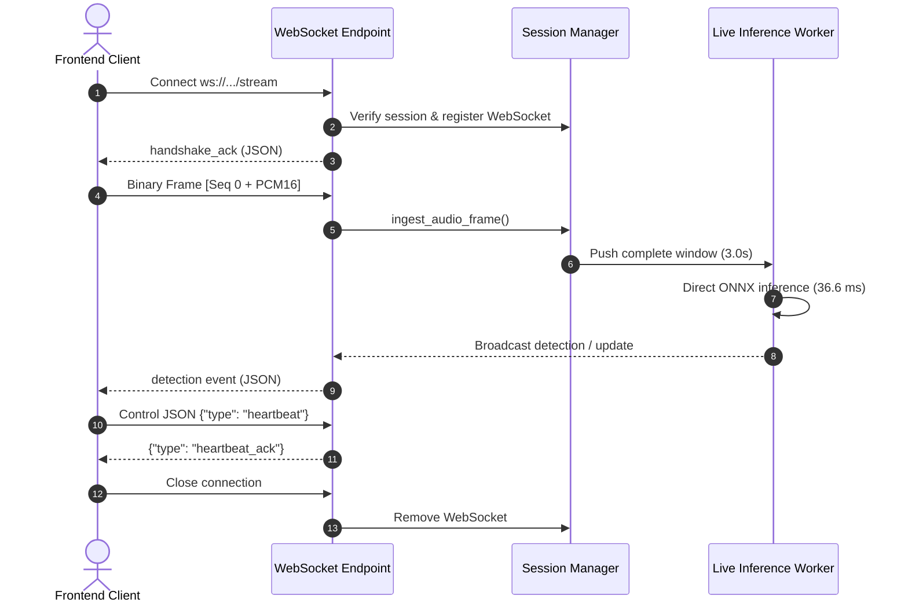

# ECOSONIC 3.0 — V1 BACKEND API CONTRACT & SPECIFICATION

**Status:** FROZEN  
**Release Target:** EcoSonic 3.0 v1 Production Frontend  
**Integration Branch:** `integration/ecosonic-v1`  
**Model Runtime:** BirdNET+ V3.0 (Direct ONNX Runtime GPU / CPU Fallback)  
**Document Classification:** Definitive Engineering Specification  

---

## 1. ARCHITECTURAL OVERVIEW & INGESTION PRINCIPLES

EcoSonic 3.0 provides real-time bioacoustic intelligence, soundscape profiling, and disturbance detection. The v1 backend API is frozen on branch `integration/ecosonic-v1` to provide a rock-solid, production-ready contract for the web and mobile frontend applications.

### 1.1 Ingestion Specifications
- **Audio Format:** 16-bit signed integer linear PCM (`int16`, little-endian).
- **Target Sample Rate:** 32,000 Hz ($f_s = 32\text{ kHz}$, native BirdNET+ V3.0 resolution).
- **Channels:** Single channel (Mono, 1 channel). If the client records in stereo or multi-channel, downmixing must occur before streaming or be handled per channel alignment.
- **Inference Window Duration:** 3.0 seconds ($96,000$ samples @ 32 kHz).
- **Hop Duration:** Configurable, default 1.5 seconds ($48,000$ samples) or 3.0 seconds ($96,000$ samples).
- **Frame Transport:** Binary WebSocket frames consisting of a 4-byte big-endian sequence number followed by raw PCM16 bytes.
- **Recommended Client Frame Cadence:** 250 ms chunks (8,000 samples = 16,000 bytes payload + 4 bytes header = 16,004 bytes total).

### 1.2 Processing Guarantees
- **Direct ONNX Persistent Inference:** Single-pass evaluation executing both species classification and 1,280-dimensional acoustic embedding extraction simultaneously within the inference worker process.
- **Execution Latency:** Median ONNX execution is **36.58 ms** on GPU (**55.14 ms** on CPU fallback). Total post-window pipeline latency is **69.12 ms** (median GPU), yielding a Real-Time Factor (RTF) of **0.02304** ($43.4\times$ faster than real time).
- **Non-Blocking Persistence:** Embedding vectors are queued asynchronously to disk (`storage/embeddings/`) and database records are flushed without blocking live audio acquisition or inference.
- **Silence vs. Quality Warnings:**
  - **Normal Silence:** Windows with $\text{RMS} < 10^{-4}$ ($-80\text{ dBFS}$) are flagged as `is_silent=True` and bypass heavy model evaluation. A lightweight `processing_update` message with `status="silent_skipped"` and `is_silent=true` is dispatched to maintain client heartbeat and progress counters.
  - **Quality Warnings:** `audio_quality_warning` events are emitted **only** for actionable physical defects, such as microphone clipping (>5% samples at maximum excursion $\pm 32767$) or malformed audio framing.

---

## 2. SYSTEM & READINESS APIS

### 2.1 System Health & Runtime Inspection
Retrieves operational status, model availability, active execution providers, and Direct ONNX readiness.

- **Endpoint:** `GET /health`
- **Authentication:** Public
- **Response Format:** JSON
- **Success Status:** `200 OK`

```json
{
  "status": "healthy",
  "service": "EcoSonic 2.0 Bioacoustic Intelligence",
  "version": "2.0.0",
  "model_version": "BirdNET+ V3.0",
  "model_ready": true,
  "model_device": "cuda",
  "direct_onnx_engine": {
    "engine": "DirectOnnxEngine",
    "initialized": true,
    "model_path": "models/BirdNET_GLOBAL_6K_V2.4_Model_FP32.onnx",
    "active_providers": [
      "CUDAExecutionProvider",
      "CPUExecutionProvider"
    ],
    "preferred_provider": "CUDAExecutionProvider",
    "num_classes": 6522,
    "embedding_dimension": 1280
  }
}
```

### 2.2 Root Discovery
- **Endpoint:** `GET /`
- **Response Format:** JSON
- **Success Status:** `200 OK`

```json
{
  "message": "Welcome to EcoSonic 2.0 Bioacoustic Intelligence API",
  "documentation": "/docs",
  "api_v1": "/api/v1"
}
```

---

## 3. LIVE SESSION LIFECYCLE REST APIS

All live streaming sessions must be initialized via REST before establishing a WebSocket connection.

### 3.1 Create Live Session
Creates a database record and allocates an in-memory session coordinator and ring buffer.

- **Endpoint:** `POST /api/v1/live/sessions`
- **Status Code:** `201 Created`
- **Request Body (`LiveSessionCreate`):**

| Field | Type | Required | Default | Description |
|---|---|---|---|---|
| `source_type` | `string` | No | `"browser_mic"` | Allowed: `"browser_mic"`, `"desktop_mic"`, `"field_device"`, `"file_replay"` |
| `device_id` | `string` | No | `null` | Hardware device UUID or label |
| `site_id` | `string` | No | `null` | UUID of registered monitoring site |
| `latitude` | `float` | No | `null` | Latitude between -90.0 and 90.0 |
| `longitude` | `float` | No | `null` | Longitude between -180.0 and 180.0 |
| `sample_rate` | `integer` | No | `32000` | Native sample rate in Hz (default 32000) |
| `channels` | `integer` | No | `1` | Channel count (default 1) |

**Sample Request:**
```json
{
  "source_type": "browser_mic",
  "device_id": "macbook_pro_mic_1",
  "site_id": "a8790100-2f1d-40bf-bb15-5853b0bc8c91",
  "latitude": 44.5012,
  "longitude": -73.5673,
  "sample_rate": 32000,
  "channels": 1
}
```

**Sample Response (`LiveSessionResponse`):**
```json
{
  "id": "e4468f78-a28a-40a2-b9e7-ea157d6ef622",
  "source_type": "browser_mic",
  "device_id": "macbook_pro_mic_1",
  "site_id": "a8790100-2f1d-40bf-bb15-5853b0bc8c91",
  "latitude": 44.5012,
  "longitude": -73.5673,
  "started_at": "2026-11-22T11:30:00.000000Z",
  "stopped_at": null,
  "status": "created",
  "sample_rate": 32000,
  "channels": 1,
  "total_audio_seconds": 0.0,
  "processed_audio_seconds": 0.0,
  "dropped_frames": 0,
  "dropped_windows": 0,
  "recording_path": null,
  "created_at": "2026-11-22T11:30:00.000000Z",
  "events_count": 0,
  "segments_count": 0
}
```

### 3.2 List Live Sessions
Lists live monitoring sessions with filtering and pagination.

- **Endpoint:** `GET /api/v1/live/sessions`
- **Query Parameters:**
  - `source_type` (`string`, optional): Filter by source type.
  - `status` (`string`, optional): Filter by status (`created`, `active`, `paused`, `stopped`, `failed`).
  - `limit` (`integer`, optional, default: 50, min: 1, max: 200).
  - `offset` (`integer`, optional, default: 0).
- **Success Status:** `200 OK`
- **Response Format:** Array of `LiveSessionResponse` objects.

### 3.3 Get Live Session Details & Real-Time Stats
Retrieves full session state, persisted biological detections, acoustic segments, and real-time hardware telemetry.

- **Endpoint:** `GET /api/v1/live/sessions/{session_id}`
- **Success Status:** `200 OK`
- **Response Format (`LiveSessionDetailResponse`):**

```json
{
  "id": "e4468f78-a28a-40a2-b9e7-ea157d6ef622",
  "source_type": "browser_mic",
  "device_id": "macbook_pro_mic_1",
  "site_id": "a8790100-2f1d-40bf-bb15-5853b0bc8c91",
  "latitude": 44.5012,
  "longitude": -73.5673,
  "started_at": "2026-11-22T11:30:00.000000Z",
  "stopped_at": null,
  "status": "active",
  "sample_rate": 32000,
  "channels": 1,
  "total_audio_seconds": 120.0,
  "processed_audio_seconds": 120.0,
  "dropped_frames": 0,
  "dropped_windows": 0,
  "recording_path": "storage/recordings/e4468f78-a28a-40a2-b9e7-ea157d6ef622.wav",
  "created_at": "2026-11-22T11:30:00.000000Z",
  "events_count": 14,
  "segments_count": 40,
  "events": [
    {
      "id": "848b8fe6-b33c-4cf8-a92c-eb022f4b46c6",
      "session_id": "e4468f78-a28a-40a2-b9e7-ea157d6ef622",
      "detection_id": "595e1e40-5a33-40e9-b5a8-2045cb23305a",
      "start_seconds": 12.0,
      "end_seconds": 15.0,
      "class_label": "Turdus migratorius",
      "scientific_name": "Turdus migratorius",
      "common_name": "American Robin",
      "confidence_score": 0.8924,
      "taxon_group": "Bird",
      "model_version": "BirdNET+ V3.0",
      "created_at": "2026-11-22T11:30:15.080000Z"
    }
  ],
  "segments": [
    {
      "id": "e0377e8a-b851-4606-ba7b-6c4ca15f5c3a",
      "session_id": "e4468f78-a28a-40a2-b9e7-ea157d6ef622",
      "start_seconds": 12.0,
      "end_seconds": 15.0,
      "audio_path": "storage/segments/e0377e8a-b851-4606-ba7b-6c4ca15f5c3a.wav",
      "embedding_path": "storage/embeddings/e0377e8a-b851-4606-ba7b-6c4ca15f5c3a.npy",
      "processing_status": "completed",
      "created_at": "2026-11-22T11:30:15.069000Z"
    }
  ],
  "stats": {
    "audio_capture_rate": 64000.0,
    "audio_input_continuity": 100.0,
    "avg_inference_latency_ms": 36.58,
    "avg_embedding_latency_ms": 0.0,
    "window_processing_lag_ms": 69.12,
    "e2e_event_delivery_latency_ms": 69.15,
    "dropped_frames": 0,
    "dropped_windows": 0,
    "processed_windows": 40,
    "inferred_windows": 28,
    "silent_windows": 12,
    "inference_queue_size": 0,
    "embedding_queue_size": 0,
    "soundscape_queue_size": 0,
    "gpu_utilization_pct": 14.5,
    "cpu_utilization_pct": 8.2,
    "peak_memory_mb": 624.5
  }
}
```

### 3.4 Stop Live Session
Gracefully stops active audio acquisition, flushes pending queues to disk and database, and closes in-memory coordinator state.

- **Endpoint:** `POST /api/v1/live/sessions/{session_id}/stop`
- **Success Status:** `200 OK`
- **Response Format:** `LiveSessionResponse` with `status="stopped"` and populated `stopped_at`.

---

## 4. WEBSOCKET STREAMING PROTOCOL

The bidirectional WebSocket endpoint handles real-time audio ingestion and live event delivery.

- **URL:** `ws://{host}:{port}/api/v1/live/sessions/{session_id}/stream`
- **Protocol:** Mixed Binary (Audio Ingestion) and Text (JSON Control & Broadcasts).

### 4.1 Connection Lifecycle


### 4.2 Binary Audio Framing Specification
Each audio frame sent from client to server **must** follow this strict binary format:

```
+-------------------------------------------------------+
|  Bytes 0..3: Sequence Number (uint32, big-endian)     |
+-------------------------------------------------------+
|  Bytes 4..N: Raw PCM16 Audio (int16, little-endian)   |
+-------------------------------------------------------+
```

1. **Sequence Number Header (4 bytes):**
   - Format: 32-bit unsigned integer in network byte order (big-endian, struct format `>I`).
   - Range: $0$ to $2^{32}-1$.
   - Continuity requirement: Strictly monotonically increasing ($0, 1, 2, \dots$). Missing numbers are flagged as dropped frames.
2. **Audio Payload (Bytes 4 through $N$):**
   - Format: 16-bit signed integer linear PCM (`<i2`, -32768 to 32767).
   - Alignment: Total payload length $(N - 4)$ **must be divisible by** $2 \times \text{channels}$ (e.g. exactly divisible by 2 for mono).
   - Maximum Frame Size: 131,072 bytes (128 KB, ~2 seconds of 32 kHz audio). Frames larger than 128 KB are rejected with `FRAME_TOO_LARGE`.
   - Maximum Transmission Rate: 200 Hz. Higher rates trigger `RATE_LIMIT_EXCEEDED`.

### 4.3 Client Control Messages (JSON from Client)
Clients can send text JSON messages over the WebSocket for session coordination:

| Control Message | Payload Structure | Action |
|---|---|---|
| `handshake` | `{"type": "handshake"}` | Requests session configuration and next expected sequence number. |
| `start` | `{"type": "start"}` | Transitions session from created/paused to active. |
| `pause` | `{"type": "pause"}` | Temporarily pauses audio processing in ring buffer. |
| `resume` | `{"type": "resume"}` | Resumes audio processing. |
| `stop` | `{"type": "stop"}` | Initiates graceful session shutdown. |
| `heartbeat` | `{"type": "heartbeat", "timestamp": 1774351800.123}` | Ping server with client timestamp. |

### 4.4 Server Broadcast Events (JSON to Client)

#### A. Handshake Acknowledgment
Sent immediately upon client connection:
```json
{
  "type": "handshake_ack",
  "session_id": "e4468f78-a28a-40a2-b9e7-ea157d6ef622",
  "status": "active",
  "sample_rate": 32000,
  "channels": 1,
  "expected_seq": 0
}
```

#### B. Heartbeat Acknowledgment
```json
{
  "type": "heartbeat_ack",
  "timestamp": 1774351800.123
}
```

#### C. Session State Changes
Dispatched when session state transitions (`session_started`, `session_paused`, `session_resumed`, `session_stopped`):
```json
{
  "type": "session_started",
  "session_id": "e4468f78-a28a-40a2-b9e7-ea157d6ef622",
  "timestamp": 1774351800.250
}
```

#### D. Biological Detection Event (`detection`)
Emitted when a biological species exceeds the confidence threshold (default $\ge 0.25$):
```json
{
  "type": "detection",
  "session_id": "e4468f78-a28a-40a2-b9e7-ea157d6ef622",
  "event_id": "848b8fe6-b33c-4cf8-a92c-eb022f4b46c6",
  "start_seconds": 12.0,
  "end_seconds": 15.0,
  "class_label": "Turdus migratorius",
  "scientific_name": "Turdus migratorius",
  "common_name": "American Robin",
  "confidence_score": 0.8924,
  "taxon_group": "Bird",
  "model_version": "BirdNET+ V3.0"
}
```

#### E. Disturbance Radar Event (`disturbance_event`)
Emitted when an anthropogenic or biological disturbance is detected (e.g. chainsaw, gunshot, motor vehicle, dog bark):
```json
{
  "type": "disturbance_event",
  "session_id": "e4468f78-a28a-40a2-b9e7-ea157d6ef622",
  "event_id": "314f3312-d85c-4eb6-b4cf-5fa624d78810",
  "event_type": "chainsaw",
  "class_label": "Chainsaw",
  "category": "anthropogenic_mechanical",
  "hazard_classification": "critical",
  "start_seconds": 45.0,
  "end_seconds": 48.0,
  "confidence_score": 0.7842,
  "model_version": "BirdNET+ V3.0",
  "review_status": "pending"
}
```

#### F. Soundscape Measurement Event (`soundscape_measurement`)
Emitted periodically (every window or rolling interval) with full ecoacoustic metrics:
```json
{
  "type": "soundscape_measurement",
  "session_id": "e4468f78-a28a-40a2-b9e7-ea157d6ef622",
  "start_seconds": 45.0,
  "end_seconds": 48.0,
  "metrics": {
    "aci": 142.85,
    "adi": 2.15,
    "aei": 0.42,
    "ndsi": 0.38,
    "spectral_entropy": 0.74,
    "temporal_activity": 0.65
  },
  "frequency_bands": {
    "anthro_0_2khz": 0.42,
    "bio_2_8khz": 0.51,
    "high_bio_8_16khz": 0.07
  },
  "quality_flags": []
}
```

#### G. Co-Occurrence Observation (`cooccurrence_observation`)
Emitted when a disturbance alters bioacoustic activity:
```json
{
  "type": "cooccurrence_observation",
  "session_id": "e4468f78-a28a-40a2-b9e7-ea157d6ef622",
  "observation_id": "902d8471-f921-4f1d-bb34-92731888a76e",
  "disturbance_event_id": "314f3312-d85c-4eb6-b4cf-5fa624d78810",
  "biological_activity_before": 0.85,
  "biological_activity_after": 0.12,
  "difference_value": -0.73,
  "interpretation": "Acoustic suppression detected following chainsaw disturbance."
}
```

#### H. Processing Progress Update (`processing_update`)
Dispatched for **every completed audio window** (both inferred and silent). This powers client progress bars and telemetry:
```json
{
  "type": "processing_update",
  "session_id": "e4468f78-a28a-40a2-b9e7-ea157d6ef622",
  "status": "processed",
  "processed_seconds": 48.0,
  "window_index": 31,
  "is_silent": false,
  "rms_energy": 0.024512,
  "inference_duration_ms": 36.58,
  "window_lag_ms": 68.20,
  "queue_size": 0,
  "detections_count": 2
}
```

*When a window is skipped due to silence:*
```json
{
  "type": "processing_update",
  "session_id": "e4468f78-a28a-40a2-b9e7-ea157d6ef622",
  "status": "silent_skipped",
  "processed_seconds": 51.0,
  "window_index": 32,
  "is_silent": true,
  "rms_energy": 0.000042,
  "start_seconds": 48.0,
  "end_seconds": 51.0,
  "queue_size": 0,
  "detections_count": 0
}
```

#### I. Quality & System Warnings
- **`audio_quality_warning`:** Emitted **only** when clipping exceeds 5% or PCM alignment fails:
  ```json
  {"type": "audio_quality_warning", "session_id": "...", "reason": "Severe clipping detected: 7.2% of samples at digital limit."}
  ```
- **`backpressure_warning`:** Emitted when worker queues fill under load:
  ```json
  {"type": "backpressure_warning", "session_id": "...", "dropped_windows": 1, "queue_size": 16}
  ```
- **`error`:** Fatal protocol or framing errors:
  ```json
  {"type": "error", "code": "INVALID_PCM_ALIGNMENT", "message": "PCM payload length 511 is not 2-byte aligned for 1 channel."}
  ```

---

## 5. SOUNDSCAPE & DISTURBANCE REST APIS

### 5.1 Retrieve Soundscape Measurements
- **Endpoint:** `GET /api/v1/live/sessions/{session_id}/soundscape`
- **Response Format:** Array of `SoundscapeMeasurementResponse` objects.

### 5.2 Retrieve Disturbance Events
- **Endpoint:** `GET /api/v1/live/sessions/{session_id}/disturbances`
- **Response Format:** Array of `DisturbanceEventResponse` objects.

### 5.3 Retrieve Unified Session Timeline
Returns a unified, chronologically sorted timeline merging biological detections, disturbance events, and soundscape measurements.

- **Endpoint:** `GET /api/v1/live/sessions/{session_id}/timeline`
- **Response Format:** Array of `TimelineItemResponse` objects:
```json
[
  {
    "id": "848b8fe6-b33c-4cf8-a92c-eb022f4b46c6",
    "session_id": "e4468f78-a28a-40a2-b9e7-ea157d6ef622",
    "item_type": "biological_detection",
    "start_seconds": 12.0,
    "end_seconds": 15.0,
    "label": "American Robin",
    "confidence_score": 0.8924,
    "details": {
      "scientific_name": "Turdus migratorius",
      "taxon_group": "Bird",
      "class_label": "Turdus migratorius"
    },
    "created_at": "2026-11-22T11:30:15.080000Z"
  },
  {
    "id": "314f3312-d85c-4eb6-b4cf-5fa624d78810",
    "session_id": "e4468f78-a28a-40a2-b9e7-ea157d6ef622",
    "item_type": "disturbance_event",
    "start_seconds": 45.0,
    "end_seconds": 48.0,
    "label": "Chainsaw",
    "confidence_score": 0.7842,
    "details": {
      "event_type": "chainsaw",
      "category": "anthropogenic_mechanical",
      "hazard_classification": "critical",
      "model_version": "BirdNET+ V3.0",
      "review_status": "pending"
    },
    "created_at": "2026-11-22T11:30:48.080000Z"
  }
]
```

### 5.4 Retrieve Latest Soundscape Fingerprint
- **Endpoint:** `GET /api/v1/live/sessions/{session_id}/fingerprint`
- **Response Format:** `SoundscapeFingerprintResponse` containing latest aggregate radar metrics.

### 5.5 Disturbance Taxonomy
- **Endpoint:** `GET /api/v1/live/disturbances/taxonomy`
- **Response Format:** Dictionary of verified sound classes, categories, and thresholds.

---

## 6. ACOUSTIC MEMORY & VECTOR SEARCH APIS

*Note: These endpoints are registered when `ENABLE_ACOUSTIC_MEMORY=true` in `app/config.py`.*

### 6.1 Vector Similarity Search
Executes exact cosine similarity search across indexed 1,280-dimensional acoustic embeddings.

- **Endpoint:** `POST /api/v1/acoustic-memory/search`
- **Request Body (`SimilaritySearchRequest`):**
```json
{
  "query_vector": null,
  "query_segment_id": "e0377e8a-b851-4606-ba7b-6c4ca15f5c3a",
  "limit": 10,
  "min_similarity": 0.75,
  "exclude_same_session": true,
  "site_id": null
}
```
- **Response Format:** Array of `SimilarityMatchResponse` objects with cosine similarity scores, segment IDs, time intervals, and metadata.

### 6.2 Get Similar Segments by Segment ID
- **Endpoint:** `GET /api/v1/acoustic-memory/segments/{segment_id}/similar`
- **Query Parameters:** `limit` (int, default 10), `min_similarity` (float), `exclude_same_session` (bool).

### 6.3 Stream Segment Audio
- **Endpoint:** `GET /api/v1/acoustic-memory/segments/{segment_id}/audio`
- **Response:** `audio/wav` file stream.

### 6.4 Acoustic Memory Index Status & Management
- **`GET /api/v1/acoustic-memory/index/status`:** Returns vector count, embedding dimension (1280), and last updated timestamp.
- **`POST /api/v1/acoustic-memory/index/rebuild`:** Re-indexes filesystem embeddings.
- **`POST /api/v1/acoustic-memory/clusters/run`:** Executes HDBSCAN unsupervised cluster discovery.
- **`GET /api/v1/acoustic-memory/visualization/projection`:** Generates or retrieves 2D UMAP projection coordinates for vector scatter plots.

---

## 7. BATCH UPLOAD & SUPPORTING APIS

### 7.1 Batch Audio File Upload
- **Endpoint:** `POST /api/v1/analyses/upload`
- **Form Data:**
  - `file`: Multipart audio file (`.wav`, `.mp3`, `.flac`, `.ogg`, `.m4a`, up to 50 MB).
  - `confidence_threshold`: Float (default `0.25`).
- **Response Format:** `AnalysisResponse` with status `"queued"` or `"processing"`.

### 7.2 Analysis Status & Results
- **`GET /api/v1/analyses/{analysis_id}/status`:** Polling endpoint for analysis progress (`queued`, `processing`, `completed`, `failed`).
- **`GET /api/v1/analyses/{analysis_id}/results`:** Returns detections, summary metrics, and embedding segment mappings.
- **`GET /api/v1/analyses/{analysis_id}/detections`:** Returns list of detections.

### 7.3 Human Review & Verification
- **`POST /api/v1/detections/{detection_id}/reviews`:**
  - Request: `{"review_status": "confirmed", "reviewer_note": "Clear song recorded"}`.
  - Allowed status: `"confirmed"`, `"rejected"`, `"uncertain"`.

### 7.4 Monitoring Sites & Reports
- **`GET /api/v1/sites` & `POST /api/v1/sites`:** Register and manage geographic monitoring sites.
- **`GET /api/v1/reports/summary`:** Aggregate biodiversity stats (species richness, detection counts).
- **`GET /api/v1/reports/export`:** Export CSV dataset for ecological research.

---

## 8. HTTP STATUS CODES & ERROR SEMANTICS

| Status Code | Error Model | Condition |
|---|---|---|
| `200 OK` | Standard Response | Successful retrieval or state update. |
| `201 Created` | Standard Response | Resource successfully created (Session, Site, Review). |
| `400 Bad Request` | `{"detail": string, "error_type": "AudioValidationError"}` | Invalid audio container, unreadable header, or unsupported rate. |
| `404 Not Found` | `{"detail": string, "error_type": "ResourceNotFoundError"}` | Session, Analysis, Segment, or Detection UUID does not exist. |
| `409 Conflict` | `{"detail": string}` | Analysis results requested before status is `completed`. |
| `422 Unprocessable` | `{"detail": string, "error_type": "AudioProcessingError"}` | Corrupted audio stream or model execution failure. |
| `500 Server Error` | `{"detail": string}` | Unhandled internal exception or missing storage volume. |

---

## 9. FROZEN API GUARANTEES

1. **Backwards Compatibility:** No schema fields will be removed or renamed in v1.
2. **Deterministic Audio Transport:** 32 kHz PCM16 with 4-byte sequence number framing is the singular standard for live streaming.
3. **Low-Latency Guarantees:** Server-side processing overhead is guaranteed under 100 ms for every complete 3-second window.
4. **Telemetry Integrity:** Window accounting ($S_{\text{eligible}} = \lfloor (S - W)/H \rfloor + 1$) strictly balances $\text{processed} = \text{inferred} + \text{silent\_skipped}$.
